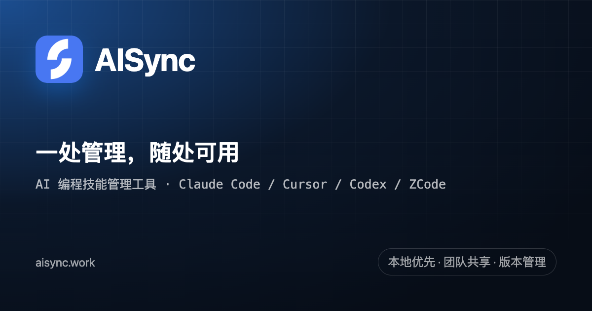
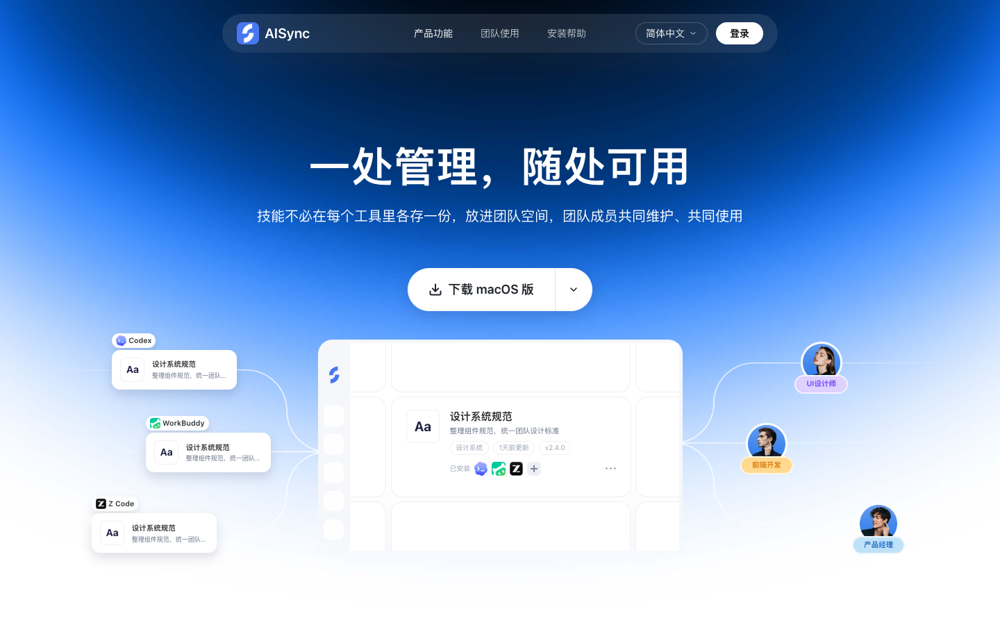
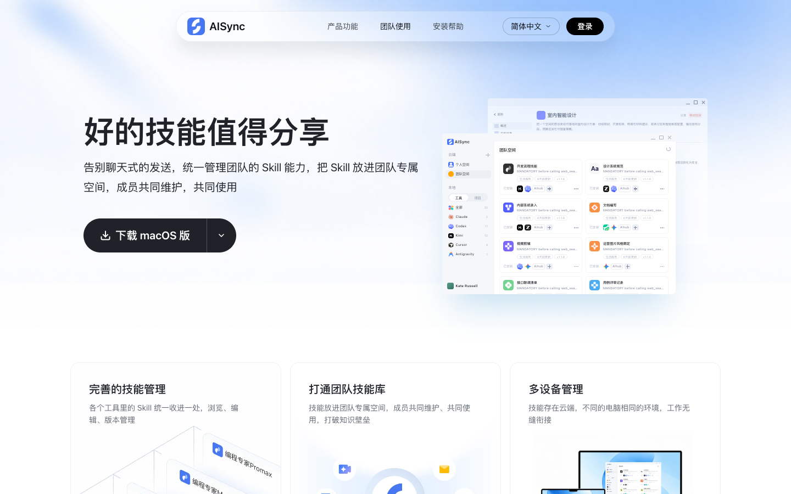

  

<h1 align="center">AISync</h1>

<strong>团队的 AI 技能库 · 一处管理，随处可用</strong>

  
  
  

  <a href="https://www.aisync.work/">官网</a> ·
  <a href="https://www.aisync.work/#download">下载</a> ·
  <a href="https://www.aisync.work/install-help">安装帮助</a> ·
  <a href="./README.en.md">English</a>

  

## AISync 是什么

AISync 是一个**本地优先的团队 AI 技能库**：把散落在 Claude Code、Cursor、Codex、ZCode 等工具里的 Agent Skills 收拢成一份可管理的资产——发现本机技能、统一版本与来源、按需安装到任意工具或项目，并共享给团队成员。

一句话：**一处管理，随处可用。**

> 这个仓库是 AISync 的产品介绍与入口，不包含客户端或服务端源码。

  

## 为什么需要 AISync

- 同一个 Skill 在 Claude Code、Cursor、Codex 里各存一份，改了一处忘了另一处
- 团队成员的技能版本不一致，交接靠聊天窗口发文件
- 换电脑、换工具后，技能要重新找、重新装
- 很难看清本机到底有哪些技能、哪个是团队最新版

AISync 把这条链路收拢成：**发现 → 上传 → 管理版本 → 安装 → 共享**。

## 核心能力

| 能力 | 说明 |
| --- | --- |
| 本机技能发现 | 扫描各工具的用户级技能目录和项目目录，按工具聚合 |
| 安装到工具 / 项目 | 一键安装到任意受支持工具或项目；同名覆盖需确认，失败可回滚 |
| 个人空间 | 上传技能到云端个人空间，管理不可变版本、历史、更新与回滚 |
| 团队空间 | 创建团队并邀请成员，把技能发布到团队空间，成员按需安装 |
| 分享安装链接 | 为指定版本生成 24 小时有效的安装链接，接收方无需客户端即可安装 |
| 版本管理 | 每次上传形成不可变版本，可查看历史、回滚 |
| 敏感内容检查 | 上传与发布前扫描技能内容，高风险内容阻断 |
| 多语言 | 简体中文 / English / 日本語 / 한국어 等 8 种语言 |
| 自动更新 | 检查新版本、校验签名、由用户确认重启 |

## 支持的 AI 编程工具

AISync 内置 24 个工具适配器：

Claude Code、Codex、Gemini CLI、Cursor、Cline、Kilo Code、Qwen Code、Roo Code、OpenCode、Trae、Windsurf、Grok、Kimi、Qoder、CodeBuddy、Augment、Antigravity、OpenClaw、Warp、Hermes、Pi、WorkBuddy、ZCode、DeepSeek Harness。

每个工具的技能目录和安装能力由对应适配器决定。如果你常用的工具不在列表里，欢迎在 Issues 里告诉我们。

## 下载与安装

- 官网：[https://www.aisync.work](https://www.aisync.work/)
- 下载：[https://www.aisync.work/#download](https://www.aisync.work/#download)
- 安装帮助（macOS / Windows）：[https://www.aisync.work/install-help](https://www.aisync.work/install-help)

支持 macOS（Apple 芯片与 Intel）和 Windows x64。

## 它是怎么工作的

1. **发现**：打开 AISync，自动扫描本机已安装工具的技能目录
2. **上传**：把技能上传到个人空间，形成可管理版本
3. **共享**：把技能发布到团队空间，邀请成员加入
4. **安装**：成员在自己的工具或项目里一键安装
5. **更新**：云端有新版本时替换本地副本，保留版本历史

## 团队空间

团队空间解决的是“同一份技能怎么让所有人用上”：

- 技能放进团队专属空间，成员共同维护
- 成员按需安装到自己的工具或项目
- 权限清晰：编辑与只读分离
- 多设备同步，换电脑不用重新找技能

## 常见问题

**AISync 需要登录吗？**

本地扫描、安装和整理不需要登录；上传、发布到团队空间等云端动作需要登录。

**支持哪些系统？**

macOS（Apple 芯片与 Intel）和 Windows x64。

**和手动拷贝 skills 有什么区别？**

AISync 管的是版本、来源和团队共享：一份技能有历史版本、有明确的来源空间，成员按需安装，不用在聊天窗口来回发文件。

**AISync 开源吗？**

这个仓库是产品介绍与入口，客户端与服务端源码暂未公开。

**Skill 是什么？**

Skill 是 AI 编程工具可以读取的一组指令和资源，通常以 `SKILL.md` 为核心文件，放在工具约定的技能目录里。

## 链接

- 官网：[https://www.aisync.work](https://www.aisync.work/)
- 下载：[https://www.aisync.work/#download](https://www.aisync.work/#download)
- 安装帮助：[https://www.aisync.work/install-help](https://www.aisync.work/install-help)
- English: [README.en.md](./README.en.md)

## 反馈

欢迎在 [Issues](https://github.com/lixiaojie-m/aisync-app/issues) 里反馈问题或建议。

如果 AISync 对你有帮助，欢迎 Star 这个仓库。

## 版权与商标

AISync 名称与 Logo 归广州求职猫科技有限公司所有。本仓库用于产品介绍与文档，不包含客户端或服务端源码；未经许可，请勿将 AISync 名称、Logo 或品牌素材用于商业用途。
